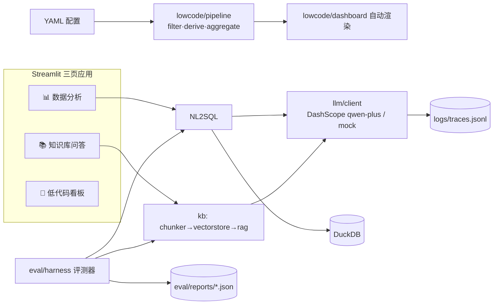

# DataCopilot Mini

一个「低代码 + 知识库 + 数据分析 + AI Harness」一体化的智能数据工作台。
上传一份 CSV 和几篇 Markdown 文档，即可用自然语言查数据、问答知识库，并用一份 YAML 配置自动生成数据看板；内置可离线回归的 AI 评测底座。

**无需任何 API Key 即可完整运行演示**（自动 mock 模式），配置 DashScope Key 后无缝升级为真实通义千问能力。

## 四大卖点

| 能力 | 实现 | 亮点 |
|------|------|------|
| 🧩 低代码 | `configs/*.yaml` → 数据管道 + 看板全自动生成 | 业务人员改 YAML/在页面编辑配置即可改版，零代码：`filter / derive / aggregate` 算子 + `line / bar / pie` 图表声明式配置，配置校验报错精确到字段路径 |
| 📚 知识库 | Markdown → 分块 → 向量检索 → RAG 问答 | numpy 余弦相似度向量库（无外部向量数据库依赖），回答附引用来源与相似度，持久化缓存可复现 |
| 📊 数据分析 | CSV 自动剖析 + NL2SQL | 缺失率/分布/重复行/Top 类别一键画像；自然语言 → SQL → DuckDB 执行，带 SQL 安全红线校验（只读 SELECT、防注入堆叠、表名限定）与一次报错自动重试 |
| ✅ AI Harness | `eval/` 双套件评测 | NL2SQL（执行成功率/列匹配率/行集一致率）+ RAG（top-k 检索命中率/关键词召回率），JSON 报告落盘，mock 模式全量可跑 = CI 友好的 AI 回归底座；全部 LLM 调用写 `logs/traces.jsonl` 可观测 |

## 架构



## 快速开始

```bash
pip install -r requirements.txt
streamlit run app/main.py
```

接真实模型（可选）：在 `.env` 中设置

```bash
DASHSCOPE_API_KEY=***   # 阿里云百炼控制台申请
USE_MOCK=0                  # 默认/未配置 key 时自动 mock
```

## AI 评测（Harness）

```bash
python -m eval.harness run                 # 全部套件（nl2sql + rag）
python -m eval.harness run --suite rag     # 只跑知识库套件
```

输出控制台 Markdown 摘要 + `eval/reports/report-<时间戳>.json`。
mock 模式下评测结果确定可复现，可直接挂 CI。

## 测试

```bash
pytest -q        # 98 个用例，全离线
```

## 目录结构

```
app/
  main.py            # Streamlit 入口（三页导航）
  config.py          # YAML 配置加载 + pydantic 校验
  llm/client.py      # DashScope 客户端 + mock 兜底 + trace 日志
  lowcode/           # 配置驱动的管道与看板渲染
  kb/                # chunker / vectorstore / rag
  analysis/          # profile / nl2sql
eval/
  harness.py         # 评测运行器（双套件注册表）
  cases/*.jsonl      # 黄金用例
configs/             # 低代码看板配置样例
data/                # 示例销售数据 + 知识库文档
tests/               # pytest（全 mock 离线）
```

## 设计取舍

- **不引入** LangChain / 向量数据库 / ORM：核心链路（分块、向量检索、SQL 生成校验、评测指标）全部手写，可解释、可面试深挖。
- **mock 优先**：LLM 客户端哈希伪向量 + 规则化 SQL 生成，保证无网络/无密钥时功能与评测体系完整可跑。
- **安全边界**：NL2SQL 输出经只读校验白名单后才进 DuckDB；失败报错回喂模型重试一次。
